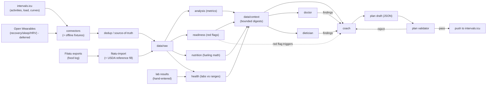

# Trinity

Open-source triathlete analysis and AI training planning.

> **Python does the math, the agent does the judgment, JSON is the contract.**

The name means two things: swim, bike, run, and a team of three agents that
look after one athlete: a **coach**, a **doctor** and a **dietician**.

Trinity pulls your training, health and nutrition data, compresses it into small,
provenance-tagged digests, and lets the three agents reason over them to build
and adjust a periodized triathlon plan. Every plan is checked by a
**deterministic validator** before anything is pushed to your calendar, and
every training adjustment is **gated by a readiness module** so the AI can't
ramp you into the ground.

> :warning: **Not medical advice.** See [`DISCLAIMER.md`](DISCLAIMER.md).

## Why this design

LLMs are good at judgment (interpreting trends, structuring a block, weighing
trade-offs) and bad at arithmetic and safety discipline. So Trinity splits the
work:

- **Python** fetches data, deduplicates it across sources, computes or fetches
  training-load and physiology metrics, runs readiness checks, and **validates**
  any plan against hard rules (ramp caps, recovery weeks, taper shape, race-day
  form target, intensity distribution, weekly-hours tolerance).
- **The agents** each read a bounded digest and supply judgment: the coach
  authors and adjusts the plan as JSON, the doctor interprets lab and recovery
  findings, the dietician judges fueling.
- **JSON** is the only contract between them. No agent sees raw streams or
  computes a number that ends up in a plan or a verdict.



## Data sources

| Concern | Source | Notes |
| --- | --- | --- |
| Activities, streams, training load (CTL/ATL/TSB), power/pace curves, eFTP | **intervals.icu** | Canonical. Fetched, not recomputed. |
| Recovery, sleep, HRV, RHR (Oura/Whoop) | **Open Wearables** | Deferred for v1; self-hosted unified API. See [`docs/open-wearables.md`](docs/open-wearables.md). |
| Food log | **Fitatu** meal-plan CSV exports | Imported with `trinity fitatu-import`. |
| Bloodwork and other health entries | **You**, in `data/health/records.yaml` | Copied from the lab report as printed, with its reference ranges. Template: [`health.sample.yaml`](data/fixtures/health.sample.yaml). |
| Nutrients the food log leaves blank | **USDA FoodData Central** | Reference composition only. Every filled value traces back to a food record, and lookups are cached so later runs work offline. |
| Workout delivery to the watch | **intervals.icu → Garmin** | Via intervals' native Garmin Connect sync. Trinity never logs in to Garmin. |

The core pipeline runs **offline** against a synthetic athlete, so you can try it
with **no accounts or API keys** (`TRINITY_OFFLINE=true`, the default).

## Quickstart

```bash
# 1. Install (uv recommended)
uv sync --extra dev

# 2. Run the offline demo pipeline on the synthetic athlete
uv run trinity fetch
uv run trinity analyze
uv run trinity readiness
uv run trinity profile
uv run trinity context

# 3. (later) point at your real intervals.icu account
cp .env.example .env   # add INTERVALS_API_KEY, set TRINITY_OFFLINE=false
```

## Commands

| Command | What it does |
| --- | --- |
| `trinity fetch` | Pull data from the sources, dedup, and persist to the partitioned raw store. |
| `trinity analyze` | Print a metrics summary (load, ramp, intensity split, HRV/RHR baselines). |
| `trinity readiness` | Compute today's readiness flag and save it for the context digest. |
| `trinity profile` | Build the provenance-tagged athlete profile; keeps agent-written interpretive fields. |
| `trinity context` | Build the bounded context digest the agent reads. |
| `trinity durability` | Aerobic decoupling and output fade from activity streams (needs live intervals.icu). |
| `trinity aero` | Fit effective CdA from outdoor race rides (needs live intervals.icu). |
| `trinity fitatu-import` | Ingest Fitatu exports into the nutrition store. |
| `trinity food-gaps` | Rank food-log products whose nutrient data is blank, by logged mass. |
| `trinity food-map` | Resolve food concepts into product → USDA mappings, pinned once settled. |
| `trinity nutrition` | Build the bounded nutrition digest (fueling and recovery). |
| `trinity health` | Build the bounded health digest: lab results against their ranges, plus wellness. |
| `trinity validate PLAN.json` | Run the deterministic guardrails. Exits non-zero on errors. |
| `trinity push PLAN.json` | Validate, then upsert the plan's events to intervals.icu. `--dry-run` writes them to a file instead. |
| `trinity build-plan SPEC.yaml` | Lint a season spec, then build its plan JSON. |
| `trinity build-report SPEC.yaml` | Build the HTML season report from the spec, plan, profile and history. |
| `trinity build-horizon SPEC.yaml` | Short view of a plan, by default this week to the year's end. |
| `trinity render-pdf FILE` | Render a markdown note or an HTML report to a print-ready PDF (needs Chrome or Chromium). |

Run `uv run trinity <command> --help` for options.

## Configuration

Everything is set through environment variables or `.env`
(template: [`.env.example`](.env.example)).

| Variable | Purpose |
| --- | --- |
| `TRINITY_OFFLINE` | `true` (default) serves the synthetic athlete and never touches the network. |
| `TRINITY_DATA_DIR` | Where data is read and written. Defaults to `data/` in the repo (git-ignored), or in the current folder when Trinity is installed as a package. |
| `TRINITY_KNOWLEDGE_DIR` | Load the rulebooks from here instead of the copy shipped in the package. |
| `INTERVALS_API_KEY`, `INTERVALS_ATHLETE_ID` | intervals.icu access. |
| `OPEN_WEARABLES_BASE_URL`, `OPEN_WEARABLES_API_KEY`, `OPEN_WEARABLES_USER_ID` | Open Wearables access (optional). |
| `FDC_API_KEY` | USDA FoodData Central, only needed the first time a food is looked up. |
| `OPENAI_API_KEY` | Only for `scripts/speak_openai.py` (text-to-speech). |

## The three agents

Each agent has its own digest to read, its own rulebook to stay inside, and a
skill that spells out its procedure. Python fills the digests; the agents never
do the arithmetic.

| Agent | Role | Reads | Rulebook (in `src/trinity/knowledge/`) | Skills |
| --- | --- | --- | --- | --- |
| **coach** | Leads. Builds and adjusts the profile and plan, talks to the athlete, and consults the other two. | `data/context/athlete.json` | `triathlon/` | `triathlete-profile`, `training-plan`, `adjust-plan` |
| **doctor** | Reviews bloodwork, illness, injury and recovery markers. Flags what needs a physician; does not diagnose or prescribe. | `data/context/health-athlete.json` | `health/` | `health-review` |
| **dietician** | Judges whether the athlete eats enough for the training, from food-log exports. | `data/context/nutrition-athlete.json` | `nutrition/` | `nutrition-review` |

The definitions live in [`.claude/agents/`](.claude/agents/) and the skills in
[`.claude/skills/`](.claude/skills/). In Claude Code, start a session as the
coach and it delegates to the other two as subagents:

```bash
claude --agent coach
```

The doctor and the dietician can also be asked directly. The same files load in
the Claude Agent SDK when project settings are enabled, which is how the team
will run when hosted. Cursor reads the same skills through `.cursor/skills`.

Only Fitatu food-log exports can be imported today; another nutrition app needs
its own importer.

## Season plans and reports

A whole season can be described in one YAML spec and built without the agent.
[`examples/`](examples/README.md) has real specs with their plans and reports.

```bash
uv run trinity build-plan   SPEC.yaml                    # lint the spec, write the plan JSON
uv run trinity validate     data/plans/<plan_id>.json    # run the guardrails
uv run trinity build-report SPEC.yaml                    # HTML season report
uv run trinity render-pdf   data/reports/<plan_id>.html  # print-ready PDF
```

The spec linter fails the build when the prose disagrees with the numbers
(declared FTP/CdA values, fuel ceiling, split totals, calendar references) or
with the dated facts in [`facts.yaml`](src/trinity/knowledge/triathlon/facts.yaml).

`trinity build-horizon SPEC.yaml` writes a shorter view of the same plan: one
block per week with hours by sport and estimated run kilometres. Its run-km
estimate is still calibrated to one athlete's paces.

Two helpers stay outside the package in `scripts/`: `model_brick_options.py`
(exploratory: compares brick-structure variants against the validator) and
`speak_openai.py` (renders text to MP3).

## How the math works

The rulebooks and their cited notes ship inside the package, under
[`src/trinity/knowledge/`](src/trinity/knowledge/): training in
[`triathlon/notes.md`](src/trinity/knowledge/triathlon/notes.md), nutrition in
[`nutrition/notes.md`](src/trinity/knowledge/nutrition/notes.md), health in
[`health/notes.md`](src/trinity/knowledge/health/notes.md). In short:

- **Per-sport stress scores** normalize to `100 = 1 h at threshold`: power TSS
  (Coggan), run rTSS / hrTSS, swim sTSS (CSS-based), so combined load is additive.
- **Fitness/Fatigue/Form (CTL/ATL/TSB)** via the Banister impulse-response model
  (τ = 42 / 7). Fetched from intervals.icu when available; recomputed to validate.
- **Physiology anchors**: FTP/eFTP (Coggan), CP/W′ (Monod–Scherrer, Skiba),
  run critical speed / Riegel extrapolation, swim CSS, LTHR; VO2max and lactate
  threshold are always flagged `estimated` unless from a lab test.
- **Readiness**: HRV vs 60-day baseline ± SWC (Plews/Hopkins), RHR elevation,
  sleep debt, ACWR (Gabbett), monotony/strain (Foster), neck-check illness rule.
- **Durability**: aerobic decoupling (Pa:Hr for runs, Pw:Hr for rides) and output
  fade from raw streams, dropped when they disagree with the device's moving pace.
- **Aero**: effective CdA from race files, corrected for wind height and course
  bearing, fitted both by energy balance and against the actual race time.
- **Nutrition**: energy availability, carbohydrate periodization, protein, and
  micronutrient flags that say `unknown` when the food log cannot support a verdict.
- **Health**: each latest lab result against the range on the report, plus cited
  screening thresholds for ferritin, transferrin saturation, haemoglobin and
  vitamin D. A result with nothing to compare against is `unknown`, never fine.

The rulebooks are plain, tunable YAML that the Python guardrails enforce:
[`triathlon/rules.yaml`](src/trinity/knowledge/triathlon/rules.yaml) (plan shape),
[`readiness.yaml`](src/trinity/knowledge/triathlon/readiness.yaml) (daily go/no-go),
[`zones.yaml`](src/trinity/knowledge/triathlon/zones.yaml) (intensity zones),
[`nutrition/rules.yaml`](src/trinity/knowledge/nutrition/rules.yaml) (fueling
thresholds) and [`health/rules.yaml`](src/trinity/knowledge/health/rules.yaml)
(lab markers and thresholds).

## Testing

```bash
uv run pytest
uv run ruff check src tests scripts
```

Tests are hermetic and offline. The context-digest golden test
(`tests/golden/context_digest.json`) locks the exact summary the agent reads.

## Project layout

```
src/trinity/
  cli.py             # the `trinity` command
  config.py          # env + paths
  knowledge/         # rulebooks + cited notes, one folder per agent:
                     # triathlon/ (coach), health/ (doctor), nutrition/ (dietician)
  connectors/        # intervals, openwearables, fitatu, fooddata (USDA), food
                     # concepts/mappings, dedup, fetch orchestration, synthetic athlete
  analysis/          # metrics, readiness, races, durability, aero, nutrition,
                     # health, profile builder, context digest
  planning/          # validator (guardrails), workout builder, season-spec
                     # engine, spec lint, prescription parsing
  reports/           # season report, short-horizon view, PDF rendering
  models/            # pydantic schemas (schema_version + provenance)
  storage/           # atomic JSON / CSV io, path conventions
scripts/             # exploratory and one-off helpers
examples/            # real season specs with data, plans and reports
data/                # your data; git-ignored apart from fixtures/
docs/                # integration guides
tests/               # offline tests, incl. a golden-file context digest
.claude/agents/      # coach, doctor, dietician
.claude/skills/      # their procedures (.cursor/skills links here)
```

## Status & roadmap

Early v1: single athlete, runs locally, offline-capable, pushes to intervals.icu.

- [x] Offline pipeline on a synthetic athlete (no accounts needed)
- [x] Provenance-tagged profile, bounded context digest, readiness gate
- [x] Deterministic plan validator + idempotent intervals.icu workout push
- [x] Nutrition analysis from Fitatu exports, with reference-data fill for blanks
- [x] Durability and aero analysis from activity streams
- [x] Spec-driven season plans and reports
- [x] Three agents (coach, doctor, dietician), each with its own digest and rulebook
- [x] Health digest from hand-entered lab results
- [x] Installable: rulebooks ship in the package, commands run outside a checkout
- [ ] Importers for nutrition apps other than Fitatu
- [ ] Live intervals.icu recording fixtures (vcr cassettes)
- [ ] Open Wearables recovery wired into readiness by default
- [ ] Pushing computed wellness (readiness / DFA-a1 / decoupling) back to intervals
- [ ] Multi-athlete support (coaching)
- [ ] Hosted deployment (scheduled runs, data outside the laptop)

## Formerly Aithlete

Trinity was called Aithlete until November 2026. Calendar events keep the
`aithlete-` prefix in their `external_id` so that events already pushed to
intervals.icu are updated in place rather than duplicated.

## Contributing

Issues and PRs welcome. Please keep the core contract intact: math and safety
live in Python (with tests), judgment lives in the agent, and JSON is the
boundary. New formulas and thresholds must cite a source in
`src/trinity/knowledge/`.

## License

MIT — see [`LICENSE`](LICENSE).
